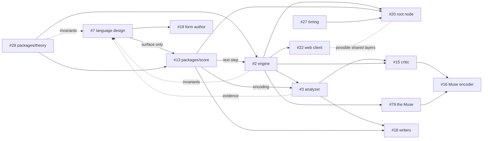

# Roadmap

Where Jambot is heading. The concept and the reasoning behind it are in
[`prototype/README.md`](../prototype/README.md). Concrete work lives on the
[issue board](https://github.com/yggi/jambot/issues).

## Targets

- **v0: locally demo-able**, by Thursday, 1 October 2026. v0 is the existing
  prototype. Anything added on top is a bonus and strengthens the case. The
  round toward it is #171 (Donnerstag): contractions that bring more of the
  engine into the app, orthogonal to the language work. Done so far: the page in
  the order of the composition (#163), the key picker and the repaired circle of
  fifths (#167), and the wiring of the Muse's attribution (#164); the rest is on
  #171's checklist.
- **v1: event-ready**, by Christmas 2026. This is the deadline. v1 is the full
  bucket: everything on this roadmap, the live track and the learning track
  alike.

## Now

The **working shape** (#37) is done: the new app plays the full band (drums,
bass, chords and lead) on its own, from the ported engine, a transport, the
synth and minimal controls. It plays the engine's raw events, so it did not wait
on the language design. MIDI out (#24, with #5 fixed) and capturing what players
play — Web MIDI in, the on-screen keys and the computer keys (#25) — are done
too, each note kept exactly where it was heard, with its release, for whenever
the Muse reads it, with their preferences and the MIDI, key and sound panel. The
on-screen keyboard and a set of drum pads mark the current key's scale and flash
for the band's own lead and drum notes, and play at once, along with the band,
from any input source (#25). The Muse hears a motif on any input, or from a
session's clients, and the lead plays it back from the bar after next, and its
panel shows the motif and its log (#79, done). The lead's status line and its
performer row name whose motif it plays, bar by bar, from the bar's own offer,
for a solo band and for a session's host and client. What is left of that is
the view: a motif bar tinted in its source's colour, and the players' own rows
in the tracks grid (#164, #183). Next for the Muse (#204), in order: reading a
sloppy hand as a musician does, with the beat, equal lengths, their ratios and
plausible rests as priors, since today's one rounding to the nearest step reads
a hand 30 ms off right in a quarter of its bars (E17, A0 done, A1 to A6 next);
a log of what players play, which A5's question and #16's encoder both need;
confidence across players (A3), which a session makes pressing and the reading's
own confidence feeds; the ear's reading of a player's style, and following it
(#16, A4); and answering a motif through its operators (U5) rather than
repeating it. What the prototype still
does that the app doesn't is the score (#63). #26's HUD is otherwise caught up:
what remains there (the score panel, Strudel export) waits on #63.

**Host and client mode** ([brief](briefs/host-mode.md)) is under way: an app
hosts a session under a name, and others join it and play its bars with their
own synth and MIDI, on its clock, their players heard by its Muse. It runs
across the tabs of one browser, and across machines through a lobby server
(`pnpm lobby`, deployed to Fly.io with `pnpm lobby:deploy`). A dropped link is no
longer the end of a session: a client rejoins as the same player by a token, the
lobby holds a session for a host whose link dropped, and a reloaded host keeps
its session (protocol 3). Hardening the lobby (#92) and WebRTC (#93) come next.

These run in parallel:

- **Language design** (#7), with its core, the theory primitive
  (`packages/theory`, #28). The score language is well reasoned but somewhat ad
  hoc, and it gets a full refinement pass, including how it relates to Strudel.
  It blocks only the language's surface: its syntax, what tokens mean, and the
  text format other code builds on. Everything else goes ahead now and feeds the
  design with the invariants and shapes it finds. That is better than deciding
  ahead of the evidence and building around the decision later. How the tracks
  feed each other is [the ratchet](ratchet.md), and the constraints, their
  tensions and the experiments that measure them are in
  [`language.md`](language.md).
- **Rebuild from the prototype**, test-first, with the prototype as a baseline
  for orientation:
  - the theory primitive in `packages/theory` (#28, done);
  - the engine (#2), the Muse (#79) included.
- **Web client** (#22): renderers (#24) and inputs (#25) are done and closed.
  Transport (#23) is down to one open question, whether to humanize timing,
  which waits on #27's hardware measurements. UI (#26) is down to the score
  panel and Strudel export, which wait on #7 and #63.
- **Analyzer** (#3, [brief](briefs/analyzer.md)): the stages that analyse
  without writing score text (loading, grid and swing, part roles, key, chords
  as pitch classes, style metrics). Its closed loop and evaluation run on the
  ported engine.

The analyzer is deterministic and rule-based, and it is the foundation of the
learned models: everything trained later sees music only through it. It is also
the biggest risk, because messy MIDI turned into clean score text decides the
quality of everything downstream.

## Event setup

### Root node (#20)

A dedicated main host appliance, a full Linux machine, that is the central
composer and conductor at an event. Web clients connect to it, and it drives the
physical instruments over USB and physical MIDI ports. Some of the web client's
layers may have parallels there. See [architecture](architecture.md#nodes).

### Timing (#27)

Timing and latency are a known issue across the system. The work starts by
measuring each path on the real hardware; a hardware MIDI clock is one
mitigation path.

## Later

### Learned models (#14)

Models never touch MIDI or audio directly; they read and write the score. The
rule composer stays permanently, as the fallback, the prior and the baseline.
Inference runs in a Worker, a section ahead, and if a model is late, the rules
play.

1. **Critic** (#15, score → style vector and genre probabilities): calibrates
   the round trip, and reranks the rule composer's candidates.
2. **Muse encoder** (#16): the critic applied to human playing, steering style
   toward the players.
3. **Writers** (#18), one per layer (harmony, lead, drums and bass): small
   transformers over score tokens, conditioned on the style axes, with
   grammar-constrained decoding.
4. **Form author** (#19): a large LLM writes forms and themes offline or between
   songs. Only small models run live.

Risk as assessed in the prototype README: the analyzer and critic are solid, the
Muse encoder and lead writer plausible, and a fully learned band that beats
rules plus reranking speculative. The architecture does not depend on the last
one.

### Root node (#20)

A dedicated main host appliance, a full Linux machine, that is the central
composer and conductor at an event. Web clients connect to it, and it drives the
physical instruments over USB and physical MIDI ports. See
[architecture](architecture.md#nodes).

Timing and latency are a known issue across the system. A hardware MIDI clock is
one mitigation path.

### Languages and rendering

Jambot's extensions to Strudel on top of Strudel, on top of MIDI or dough. MIDI
instruments and dough nodes are rendering nodes, side by side. See
[architecture](architecture.md#languages). The Strudel and dough targets get
their issues once #7 is decided.

### Open threads

Listed in full in [`prototype/README.md`](../prototype/README.md#open-threads),
grouped as language, music, system, and a separate speculative track. The
speculative track's self-reference, fixed points and coarse-graining are being
turned into claims with tests in [`quinetic.md`](quinetic.md) (#39).

## Dependencies

Only known dependencies are drawn. Each issue lists the ones that are still
unknown. Dotted lines are not blocking.

The theory primitive (#28) is the root, and the engine (#2) is the hub:
everything live and everything learned depends on it. Both can start now.

v1 needs the full bucket, so the critical path is the longest chain, the
learning track. It runs from theory and the language design, through the score
package and the engine, to the analyzer, then the critic and the Muse encoder,
with the writers alongside the critic. Training takes time beyond the code,
which puts this chain first in line. The live track (web client, root node,
timing) runs in parallel. v0 is the prototype, so nothing is on its critical
path.
