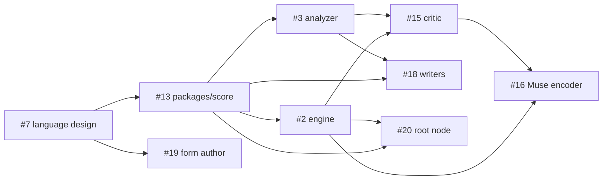

# Roadmap

Where Jambot is heading. The concept and the reasoning behind it are in
[`prototype/README.md`](../prototype/README.md). Concrete work lives on the
[issue board](https://github.com/yggi/jambot/issues).

## Now

**Language design** (#7). The score language is well reasoned but somewhat
ad hoc, and it gets a full refinement pass before anything builds on it. This
includes how it relates to Strudel. It blocks the port.

**Port the prototype**, test-first and pinned to the prototype's output:
the score core into `packages/score` (#13), then the engine (#2).

## Next

**The analyzer: MIDI files → score text** (#3,
[brief](briefs/analyzer.md)). It is deterministic and rule-based, and it is
the foundation of the learned models: everything trained later sees music
only through it. It is also the biggest risk, because messy MIDI turned into
clean score text decides the quality of everything downstream. Its first
milestone is the score core (#13), shared with the port.

## Later

### Learned models (#14)

Models never touch MIDI or audio directly; they read and write the score. The
rule composer stays permanently, as the fallback, the prior and the
baseline. Inference runs in a Worker, a section ahead, and if a model is
late, the rules play.

1. **Critic** (#15, score → style vector and genre probabilities): calibrates
   the round trip, and reranks the rule composer's candidates.
2. **Muse encoder** (#16): the critic applied to human playing, steering
   style toward the players.
3. **Writers** (#18), one per layer (harmony, lead, drums and bass): small
   transformers over score tokens, conditioned on the style axes, with
   grammar-constrained decoding.
4. **Form author** (#19): a large LLM writes forms and themes offline or
   between songs. Only small models run live.

Risk as assessed in the prototype README: the analyzer and critic are
solid, the Muse encoder and lead writer plausible, and a fully learned band
that beats rules plus reranking speculative. The architecture does not
depend on the last one.

### Root node (#20)

A dedicated main host appliance, a full Linux machine, that is the central
composer and conductor at an event. Web clients connect to it, and it drives the physical
instruments over USB and physical MIDI ports. See [architecture](architecture.md#nodes).

Timing and latency are a known issue across the system. A hardware MIDI
clock is one mitigation path.

### Languages and rendering

Jambot's extensions to Strudel on top of Strudel, on top of MIDI or dough.
MIDI instruments and dough nodes are rendering nodes, side by side. See
[architecture](architecture.md#languages).

### Open threads

Listed in full in
[`prototype/README.md`](../prototype/README.md#open-threads), grouped as
language, music, system, and a separate speculative track.

## Dependencies

Only known dependencies are drawn. Each issue lists the ones that are still
unknown.

Everything starts at #7 and #13. After that the work splits into two tracks:
the live track (engine, then root node) and the learning track (analyzer,
then critic, then Muse encoder and writers). Which one is critical depends on
the next target, which is not set yet (see below).

## Milestones and dates

_Open._
