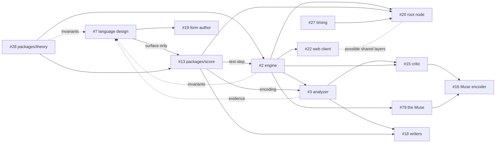

# Roadmap

Where Jambot is heading. The concept and the reasoning behind it are in
[`prototype/README.md`](../prototype/README.md). Concrete work lives on the
[issue board](https://github.com/yggi/jambot/issues).

## Targets

- **v0: locally demo-able**, by Thursday, 1 October 2026. v0 is the existing
  prototype. Anything added on top is a bonus and strengthens the case. The
  round toward it, #171 (Donnerstag), is done: contractions that brought more of
  the engine into the app, orthogonal to the language work. The page follows the
  order of the composition, the key follows the band's harmony, licences come
  from the style, the lead follows the style and walks a melodic scale, the
  tracks are one grid, and the Muse reads a sloppy hand.
  The round after it is #212: the band's screen as cards, a summary over
  details (`Card`). The style, metrum, key, plan, chords, band, play and Muse
  cards are in, closed cards are compact on a phone on its side, and the lobby
  is built of cards under a title card with a theme setting (#254).
  Left: `Level` removed, and the visual details of Band, Play and Muse.
- **v1: event-ready**, by Christmas 2026. This is the deadline. v1 is the full
  bucket: everything on this roadmap, the live track and the learning track
  alike.

## Now

The **working shape** (#37) is done: the new app plays the full band (drums,
bass, chords and lead) on its own, from the ported engine, a transport, the
synth and minimal controls. It plays the engine's raw events, so it did not wait
on the language design. MIDI out (#24, with #5 fixed) and capturing what players
play — Web MIDI in, the on-screen keys and the computer keys (#25) — are done
too, each note kept exactly where it was heard, with its release, for whenever
the Muse reads it, with their preferences and the MIDI, key and sound panel. The
on-screen keyboard and a set of drum pads mark the current key's scale and flash
for the band's own lead and drum notes, and play at once, along with the band,
from any input source (#25). The Muse hears a motif on any input, or from a
session's clients, and the lead plays it back from the bar after next, and its
panel shows the motif and its log (#79, done).
The lead's status line and the tracks grid name whose motif it plays, bar by bar, from the bar's own offer, for a solo band and for a session's host and client (#164, #183, done).
The band starts on a bar of clicks and ends on request with a last bar that closes on a cadence and rings on; a session's host tells its clients which bar is last (#267, protocol 7, so older builds and the lobby need the same release).
The lobby's metronome plays one bar of any named meter on the device's own synth (#259, #270), so a meter is heard before the engine plays one; a bar carries its meter (#260, slice 1, #272), and the drums read it (#277, any bar of a named meter, 4/4 unchanged); the bass and comp do too (#283), and so do the lead, the Muse, the dynamics and the ending (#289); the transport, the swing and the web's readers still run on the song's 4/4 clock until a section's meter (#261, #262), and the hemiola and ternary swing still wait for a hearing.
The score writes the bass as `step=pitch` pairs, and the pad and stab as `step=ch|nx` pairs with a `next` line (#63 step 3, #280, #281); a `frame` line pins a part's register or voicing as integers above the tonic only where its hand is not the default (#285); the score states no scale and refuses no chord for having none, U3 being vitrified (#292); a loop, a group, a rest, a hold and a finer grid wait for the tree of #275, whose first measurement is E27 (#282).
The lead's text waits on the cell (#287): a shared library of named cells, and `realize` sorted into what the score states (the cell, its operator, the anchor) and what a player fits (the chord tones a note snaps to, the octave), so that the Muse's cell is the minimal case.
The tuner (#269) has its pure parts in (slices 1 and 2, #273): `frequencyOf` and `pitchOf` in theory, and `packages/spectrum` with an FFT, peaks and two pitch estimators.
Its screen is built too (slice 3): a microphone or line in, the note heard in cents and Hz against a settable A4, a spectrum whose pitch frame follows the sound, and the lobby's Extras to reach it.
The waterfall, a note to hold on the synth or a MIDI channel to tune an instrument by, and the loop that hears the app's own synth (read within 0.05 cents from A1 to A6) are built too (slices 4 to 6).
Auto-tune, per channel, and the width, harmonics and fingerprint of a note come next; a measurement of what correcting live audio toward the score's notes takes (#293) found the pitch shifters the easy part and the tracker, which has only the past, the hard one, with about 15 to 40 ms of algorithmic delay before the audio hardware.
Live correction of an audio input toward a scale is under way (#298): a streaming PSOLA, a tracker and a corrector are in `packages/spectrum`, and the Tune screen has a Correct card that runs them in an AudioWorklet, measured in Chromium; the score's own scale and chord as the target, streaming between a host and its clients, and hardware come next.
The lead's lane tints a motif's bars in its player's colour, over that player's own lane, which marks the bar the Muse took.
Next for the Muse (#204), in order: reading a sloppy hand as a musician does, with the beat, equal lengths, their ratios and plausible rests as priors, since today's one rounding to the nearest step reads a hand 30 ms off right in a quarter of its bars, and the Muse's reading of a phrase in 46% (E17; H0 to H6 done: her judgement reads phrases, carries a confidence, and the surest reading is taken; H8: she remembers the motifs she took, fading, and hears one played again, by anyone and under an operator, as the one remembered, which confirms it, E20).
The reading is one with the analyzer's `quantiseSection`, a shared reader in the engine, and it hears a phrase, not a bar: she listens across bars until the player leaves a bar empty, and what she does with a phrase (motifs and their order, variations, a composer's memory) is #207;
a log of what players play, which A5's question and #16's encoder both need;
what the confidence is worth against real players (#204, H7: the lobby's timing test records how people follow a pattern, with every timing detail, to download and analyse; the first ten runs of one player are E21: a spread of 33 to 64 ms, late by about 13 ms, offbeats later than downbeats), and how long she waits on a phrase that runs on; the ear's reading of a player's style, and following it (#16, A4); and answering a motif through its operators (U5) rather than repeating it.
After Thursday, #195 (nudges fed back up), #204 (the Muse's reading) and #207 (the composer's memory) are built as one loop that recurs at every level, the note, the harmony, the phrase and the style (#210, C9): hold a default and a licence, fill it, read the fill back up, remember it fading, and lean the default toward the memory.
The key runs all five on a fading memory (`fading.ts`), measured (E19), and each epic builds its missing arrows on that form.
Left alone, the key wanders without returning (Q11); whether a level needs a default of its own to return to is the owner's call.
What the prototype still
does that the app doesn't is the score (#63). #26's HUD is otherwise caught up:
what remains there (the score panel, Strudel export) waits on #63.

**Host and client mode** ([brief](briefs/host-mode.md)) is under way: an app
hosts a session under a name, and others join it and play its bars with their
own synth and MIDI, on its clock, their players heard by its Muse. It runs
across the tabs of one browser, and across machines through a lobby server
(`pnpm lobby`, deployed to Fly.io with `pnpm lobby:deploy`). A dropped link is no
longer the end of a session: a client rejoins as the same player by a token, the
lobby holds a session for a host whose link dropped, and a reloaded host keeps
its session. Hardening the lobby (#92) and WebRTC (#93) come next.

These run in parallel:

- **Language design** (#7), with its core, the theory primitive
  (`packages/theory`, #28). The score language is well reasoned but somewhat ad
  hoc, and it gets a full refinement pass, including how it relates to Strudel.
  It blocks only the language's surface: its syntax, what tokens mean, and the
  text format other code builds on. Everything else goes ahead now and feeds the
  design with the invariants and shapes it finds. That is better than deciding
  ahead of the evidence and building around the decision later. How the tracks
  feed each other is [the ratchet](ratchet.md), and the constraints, their
  tensions and the experiments that measure them are in
  [`language.md`](language.md), whose entries sit in one file per layer (time,
  pitch, state, surface, analysis). [`shape.md`](shape.md) lays the catalogues
  over the code, one row per level, and lists what is decided and not yet built
  (#255).
- **Rebuild from the prototype**, test-first, with the prototype as a baseline
  for orientation:
  - the theory primitive in `packages/theory` (#28, done);
  - the engine (#2), the Muse (#79) included.
- **Web client** (#22): renderers (#24) and inputs (#25) are done and closed.
  Transport (#23) is down to one open question, whether to humanize timing,
  which waits on #27's hardware measurements. UI (#26) is down to the score
  panel and Strudel export, which wait on #7 and #63.
- **Analyzer** (#3, [brief](briefs/analyzer.md)): the stages that analyse
  without writing score text (loading, grid and swing, part roles, key, chords
  as pitch classes, style metrics). Its closed loop and evaluation run on the
  ported engine.

The analyzer is deterministic and rule-based, and it is the foundation of the
learned models: everything trained later sees music only through it. It is also
the biggest risk, because messy MIDI turned into clean score text decides the
quality of everything downstream.

## Event setup

### Root node (#20)

A dedicated main host appliance, a full Linux machine, that is the central
composer and conductor at an event. Web clients connect to it, and it drives the
physical instruments over USB and physical MIDI ports. Some of the web client's
layers may have parallels there. See [architecture](architecture.md#nodes).

### Timing (#27)

Timing and latency are a known issue across the system. The work starts by
measuring each path on the real hardware; a hardware MIDI clock is one
mitigation path.

## Later

### Learned models (#14)

Models never touch MIDI or audio directly; they read and write the score. The
rule composer stays permanently, as the fallback, the prior and the baseline.
Inference runs in a Worker, a section ahead, and if a model is late, the rules
play.

1. **Critic** (#15, score → style vector and genre probabilities): calibrates
   the round trip, and reranks the rule composer's candidates.
2. **Muse encoder** (#16): the critic applied to human playing, steering style
   toward the players.
3. **Writers** (#18), one per layer (harmony, lead, drums and bass): small
   transformers over score tokens, conditioned on the style axes, with
   grammar-constrained decoding.
4. **Form author** (#19): a large LLM writes forms and themes offline or between
   songs. Only small models run live.

Risk as assessed in the prototype README: the analyzer and critic are solid, the
Muse encoder and lead writer plausible, and a fully learned band that beats
rules plus reranking speculative. The architecture does not depend on the last
one.

### Root node (#20)

A dedicated main host appliance, a full Linux machine, that is the central
composer and conductor at an event. Web clients connect to it, and it drives the
physical instruments over USB and physical MIDI ports. See
[architecture](architecture.md#nodes).

Timing and latency are a known issue across the system. A hardware MIDI clock is
one mitigation path.

### Languages and rendering

Jambot's extensions to Strudel on top of Strudel, on top of MIDI or dough. MIDI
instruments and dough nodes are rendering nodes, side by side. See
[architecture](architecture.md#languages). The Strudel and dough targets get
their issues once #7 is decided.

### Open threads

Listed in full in [`prototype/README.md`](../prototype/README.md#open-threads),
grouped as language, music, system, and a separate speculative track. The
speculative track's self-reference, fixed points and coarse-graining are being
turned into claims with tests in [`quinetic.md`](quinetic.md) (#39).

## Dependencies

Only known dependencies are drawn. Each issue lists the ones that are still
unknown. Dotted lines are not blocking.

The theory primitive (#28) is the root, and the engine (#2) is the hub:
everything live and everything learned depends on it. Both can start now.

v1 needs the full bucket, so the critical path is the longest chain, the
learning track. It runs from theory and the language design, through the score
package and the engine, to the analyzer, then the critic and the Muse encoder,
with the writers alongside the critic. Training takes time beyond the code,
which puts this chain first in line. The live track (web client, root node,
timing) runs in parallel. v0 is the prototype, so nothing is on its critical
path.
